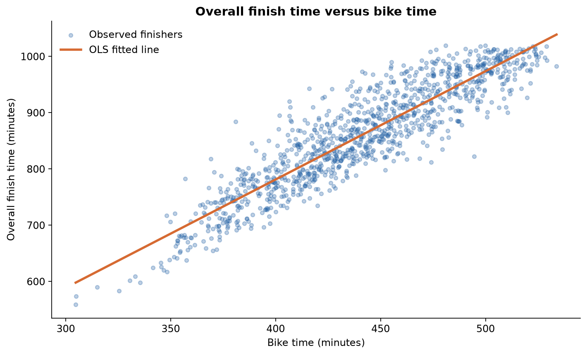
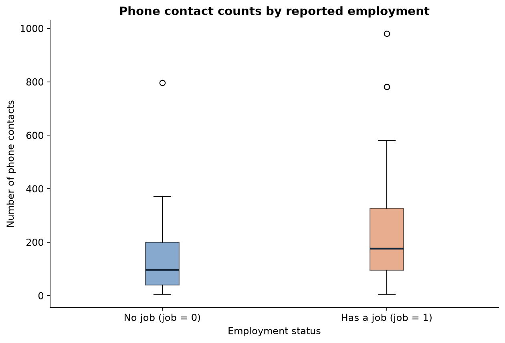

# Triathlon Performance & Survey Analysis

A reproducible analysis of race performance, simple linear regression, survey comparisons, and responsible interpretation.

**[Read the finished analysis →](https://juanthom99.github.io/DTSC2301_HW/)** · [Open the executed notebook](analysis.ipynb)



## Overview

The race analysis uses **1,105 female finishers** from the 2018 and 2019 Lake Placid Ironman events. It compares bike time and run time as individual predictors of overall finish time, with equations, contextual interpretations, diagnostics, and a held-out-year comparison.

A separate analysis constructs an employment indicator from a class survey and compares phone contact counts. An attributed ethics reflection explains the difference between avoiding harm and actively pursuing beneficial outcomes.

## Findings

| Predictor | Full-sample R² | Full-sample RMSE | 2019 held-out RMSE |
| --- | ---: | ---: | ---: |
| Bike time | 0.8281 | 38.87 minutes | 41.50 minutes |
| Run time | 0.8031 | 41.60 minutes | 43.46 minutes |

Bike time performs better in these comparisons. The held-out check trains on **587 finishers from 2018** and evaluates on **518 from 2019**. It is a single-year validation, not evidence of general performance across all events.

Overall time includes bike and run time. These relationships are partly built into the outcome and are **retrospective associations**, not pre-race forecasts or causal effects. Both intercepts correspond to zero segment time, outside the observed ranges, and should not be interpreted as realistic race predictions.

The survey has **67 responses**, of which **65** have usable employment and contact-count values. Median contact counts are **97 without a job** and **175 with a job**, with overlapping middle-50% ranges. The small convenience sample does not establish that employment causes the difference or represents all students.



## Analysis contents

| Section | Included work |
| --- | --- |
| 1. Swim and run times | Scatterplot by race year, descriptive association, and interpretation |
| 2. Bike-time regression | Fitted line, equation, R², and slope/intercept interpretations |
| 3. Run-time regression | Fitted line, equation, R², and slope/intercept interpretations |
| 4. Model comparison | Matched full-sample metrics, held-out-year RMSE, residual plots, and limitations |
| 5. Employment and contacts | Explicit `job` construction, missing-value handling, side-by-side boxplot, and group summaries |
| 6. Ethics reflection | Three sourced responses interpreting Bill Schmarzo's passive/proactive ethics argument |

## Reproduce the results

Use Python 3.11 or later in a dedicated environment:

```bash
python -m venv .venv
# Activate .venv using the command for your operating system.
python -m pip install -r requirements.txt
jupyter lab analysis.ipynb
```

Run all cells from the repository root. The notebook uses bundled snapshots, regenerates the figures and summary tables, and needs no API keys or live data connection. Its checked-in outputs show a complete execution with **six code cells and no errors**.

The published HTML report hides code for easier reading. The notebook retains the complete implementation and outputs.

## Data and attribution

Source snapshots were retrieved on October 27, 2026. See [data notes](data/README.md) for the source URLs, retained fields, units, and cleaning decisions. Unneeded identifiers and survey fields are excluded from the snapshots.

The ethics section attributes its argument to [Bill Schmarzo's author-published article](https://www.linkedin.com/pulse/ai-ethics-challenge-understanding-passive-versus-bill-schmarzo). No article text is reproduced at length.

This repository develops material from completed DTSC2301 coursework into a reproducible public analysis. It is an analysis project rather than an interactive prediction service.

## Repository guide

- `analysis.ipynb` — executed analysis with code, plots, and interpretations.
- `docs/index.html` — standalone reading version, published with GitHub Pages.
- `data/` — minimal source snapshots, provenance notes, and generated summary tables.
- `figures/` — exported plots used in the report and README.
- `requirements.txt` — dependencies for reproducing the notebook.
